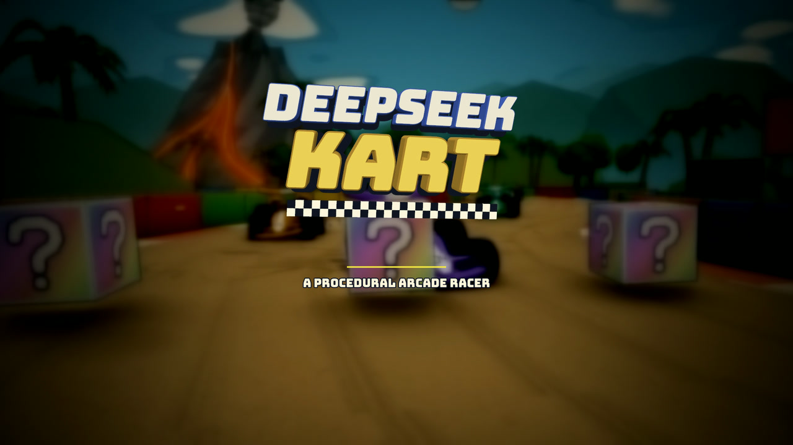

# Deepseek Kart

A procedural arcade kart racer built with HTML, TypeScript and Three.js. Five
courses, five karts, drift/mini-turbo, items and three-lap races against four CPU
rivals.

[](media/deepseek-kart-trailer.mp4)

▶ [Watch the 27-second trailer](media/deepseek-kart-trailer.mp4) — in-game
attract-mode footage from Deepseek Raceway, Sunstone Ruins and Lamplight City.
The MP4 is 1080p and silent.

## Quick start

```bash
npm install
npm run dev
```

Open the address printed by Vite (defaults to `http://localhost:5173`). Add
`?track=<id>` to skip the opening cinematic and go straight to that course's
start screen.

To play on a phone over the local network, run `npm run dev -- --host` and open
the printed Network URL. Motion sensors require HTTPS outside `localhost`.

## Controls

### Keyboard

| Key | Action |
|---|---|
| `W` / `↑` | Accelerate |
| `S` / `↓` | Brake; reverse after stopping |
| `A` / `←` | Steer left |
| `D` / `→` | Steer right |
| `Space` / `Shift` | Hop; hold + steer to drift |
| `E` | Use the current item |
| `R` | Restart race, kart and camera |
| `M` | Mute or unmute sound |
| `H` | Toggle help |
| `T` | Toggle debug HUD |

### Mobile

Mobile play is **landscape only**. Rotating the phone to portrait pauses the
race behind a rotate gate. The first tap requests fullscreen, and START also
attempts a landscape orientation lock when supported.

| Control | Action |
|---|---|
| Tilt phone | Steer |
| **GAS** (right, hold) | Accelerate |
| **BRAKE** (right, hold) | Brake; reverse after stopping |
| **JUMP** (left, hold) | Hop; keep holding with tilt to drift |
| **ITEM** (left, tap) | Use the current item |

On iOS, allow motion access when prompted at **START RACE**. Gyro steering is
required on mobile; there is no touch-steering fallback. iPhone Safari only
hides the browser header in standalone mode: use **Share → Add to Home Screen**.

## Courses

| ID | Course | Character |
|---|---|---|
| `deepseek-raceway` | Deepseek Raceway | Tropical dirt circuit with a lagoon, volcano and start village |
| `meadow-loop` | Meadow Loop | Asphalt circuit through fields, hills and forest |
| `vanilla-lake` | Vanilla Lake | Ice circuit with banked turns, ramps, holes and penguins |
| `sunstone-ruins` | Sunstone Ruins | Desert circuit with a covered stone tunnel and pyramids |
| `lamplight-city` | Lamplight City | Night street circuit with an overpass and city blocks |

An unknown `?track` ID falls back to Deepseek Raceway.

## How it plays

- **Race:** three laps, three ordered checkpoints and five karts. The start has
  a flyover and a 3-2-1-GO countdown; the results panel shows position, best lap
  and every lap time.
- **Drift:** above 6 m/s, hold `Space`/`Shift` and steer. Charge reaches 100% in
  about 1.6 s, with mini-turbo tiers at 33%, 66% and 95%.
- **Items:** oil cans, bouncing white missiles, homing red missiles, lightning
  boosts and triple charges. Item boxes respawn after 3 s.
- **Rescue:** falling into a hole or leaving the map returns the kart to the
  last safe point; the timer keeps running. A wrong-way alert warns when driving
  against the route.
- **Rivals:** four CPUs with NORMAL and HARD difficulty, lane offsets, corner
  braking, drifting and tactical item use.
- **Sound:** the engine, effects and five course themes are synthesized at
  runtime with the Web Audio API. There are no audio files.

## Technical notes

- **WebGPU** is the primary renderer, with an automatic **WebGL 2** fallback.
- The simulation runs at a fixed **60 Hz**; rendering interpolates between ticks.
- The 3D drawing buffer adapts to sustained frame times. HTML and controls stay
  at display resolution.
- Touch devices start with a lighter visual-quality profile to protect frame
  rate; gameplay geometry and collisions are unchanged.
- All art and audio are procedural. The only bundled runtime asset is the
  Bungee font.

## Development

```bash
npm test          # full Vitest suite
npm run build     # typecheck + production build
npm run preview   # preview the production build
```

A static Vite build can be deployed from `dist` (for example on Vercel, with
`npm run build` as the build command).

## Documentation

- [`AGENTS.md`](AGENTS.md) — architecture, rendering rules, gameplay systems,
  course implementation notes, tuning, debug hooks and known limitations.
- [`src/tracks/README.md`](src/tracks/README.md) — how to add a course.

## Background

Built as an experiment with a clean OpenCode 2.0 setup and DeepSeek V4.1 Flash.
Later physics and modeling corrections were made with GPT Sol 6.1.
